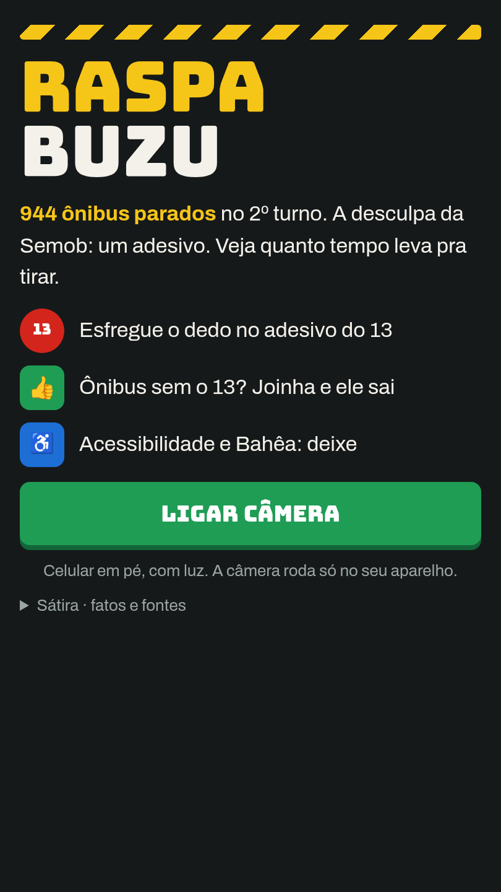
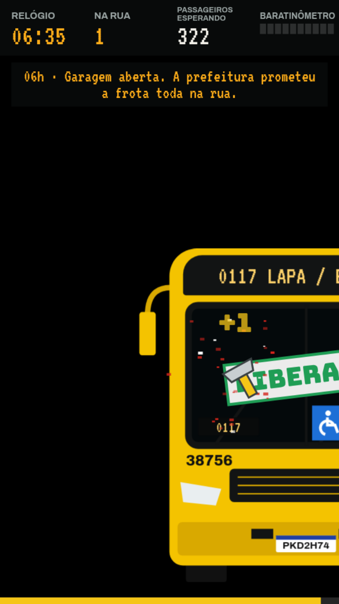
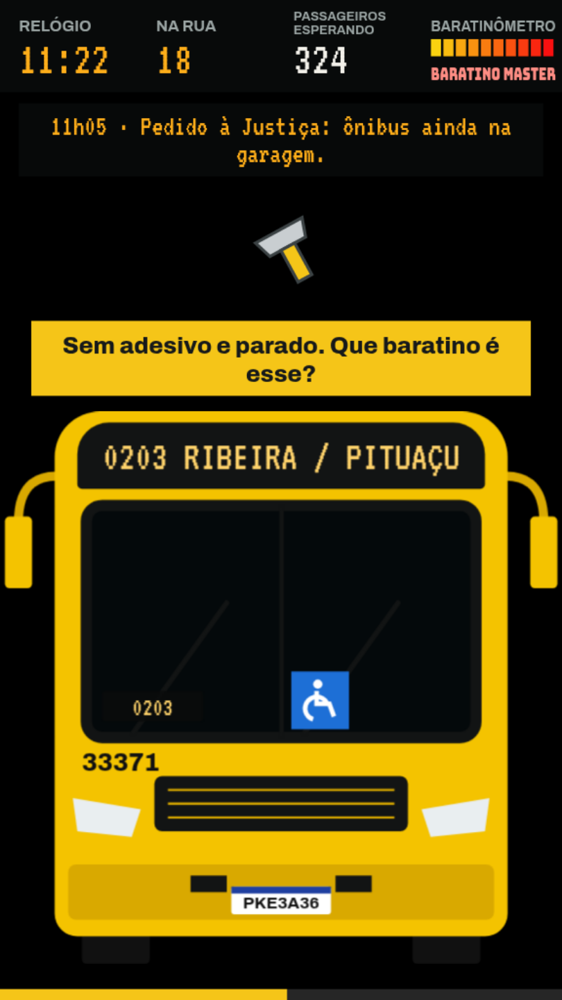
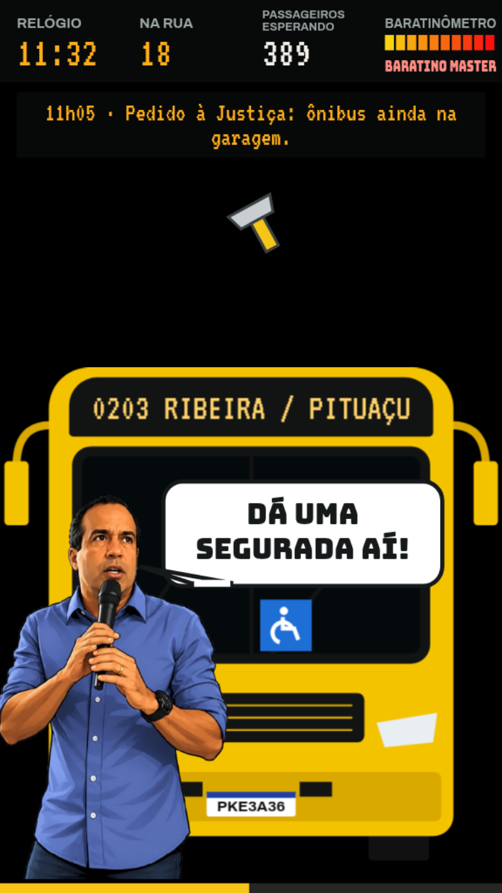
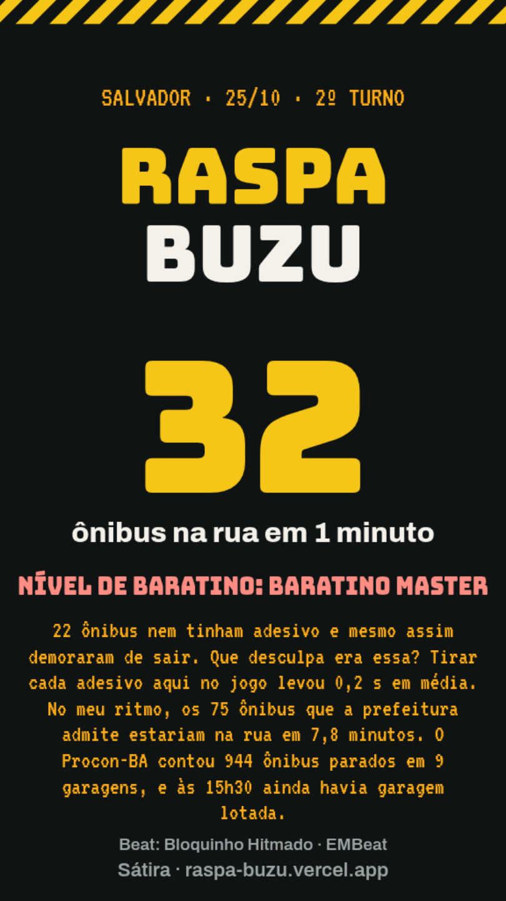

# Raspa Buzu

**Jogue:** https://raspa-buzu.vercel.app

Jogo de sátira sobre os ônibus retidos nas garagens de Salvador no 2º turno de 2026 (25/10).
A desculpa oficial foi um adesivo no para-brisa. O jogo mostra quanto tempo leva para tirar um:
você raspa o adesivo do 13 com o dedo, na frente da câmera do celular, e libera os ônibus com um joinha.

Os fatos citados no jogo têm fonte (painel "Sátira · fatos e fontes"). As falas do secretário e do
prefeito são ficção.

<p>
  
  
  
  
  
</p>

<sub>Prints feitos no modo de teste com mouse. No jogo de verdade, o fundo é a imagem da câmera frontal.</sub>

## Como joga

- **Rodada de 1 minuto.** O relógio do jogo vai de 06h00 a 17h00.
- **Raspe** o adesivo do 13 esfregando a ponta do indicador nele.
- **Joinha** 👍 libera ônibus sem adesivo. Antes das 12h20, a "regra da Semob" segura quem tem o 13.
- **Deixe** o adesivo de acessibilidade e os de time ou igreja; mexer neles trava o ônibus.
- **Baratinômetro** sobe a cada ônibus sem adesivo que você libera: Migué, Quatchá quatchá, Baratino master.
- No fim, o jogo entrega um **vídeo da rodada** (até 60 s, para story ou status) e uma **imagem do placar**, prontos para compartilhar.

Tudo roda no aparelho: a câmera não sai do celular.

## Stack

- **TypeScript + Vite**, sem framework de UI. O jogo é desenhado num `<canvas>` 2D.
- **MediaPipe Tasks Vision** (Gesture Recognizer) num Web Worker, para achar a ponta do dedo e o joinha.
- **MediaRecorder** grava o canvas com o áudio (Web Audio); **Web Share API** compartilha o vídeo.
- **Vercel** para hospedagem e Web Analytics.

Feito e testado num Android intermediário (Galaxy A17): desenho limitado a 30 fps para sobrar GPU para o detector,
que faz de 6 a 9 detecções por segundo.

## Rodando local

```bash
pnpm install
pnpm dev     # abre /camera/
pnpm test
pnpm build
```

Sem câmera, use `?mouse=1`: arrastar com o mouse raspa, **W** ou espaço é o joinha, **P** mostra o prefeito
e **E** pula para o fim. `?debug=1` mostra detecções por segundo e tempo de inferência.

A câmera exige HTTPS fora do `localhost`. Para testar no celular pela rede local: `pnpm spike:lan`.

## Organização

| Caminho | O quê |
|---|---|
| `camera/index.html` | Página do jogo |
| `src/camera/main.ts` | Loop, desenho, placar, tela final |
| `src/camera/hands.ts`, `hand-worker.ts` | Detecção da mão (worker) e suavização do cursor |
| `src/camera/recorder.ts` | Gravação do vídeo |
| `src/sim.ts` | Regras e sorteio dos ônibus |
| `src/content.ts` | Textos, eventos do relógio, baratinômetro, legenda de compartilhar |
| `tests/` | Testes (`node --test`) |
| `legacy/` | Versão 1, jogada pelo toque |

## Créditos

- Música: "Bloquinho Hitmado", de EMBeat ([@esdrassmiranda_](https://www.instagram.com/esdrassmiranda_/)), usada sem fins comerciais.
- Fontes dos fatos: Procon-BA (via Governo da Bahia e BNews), Correio, bahia.ba e InfoMoney. Os links estão no jogo.
